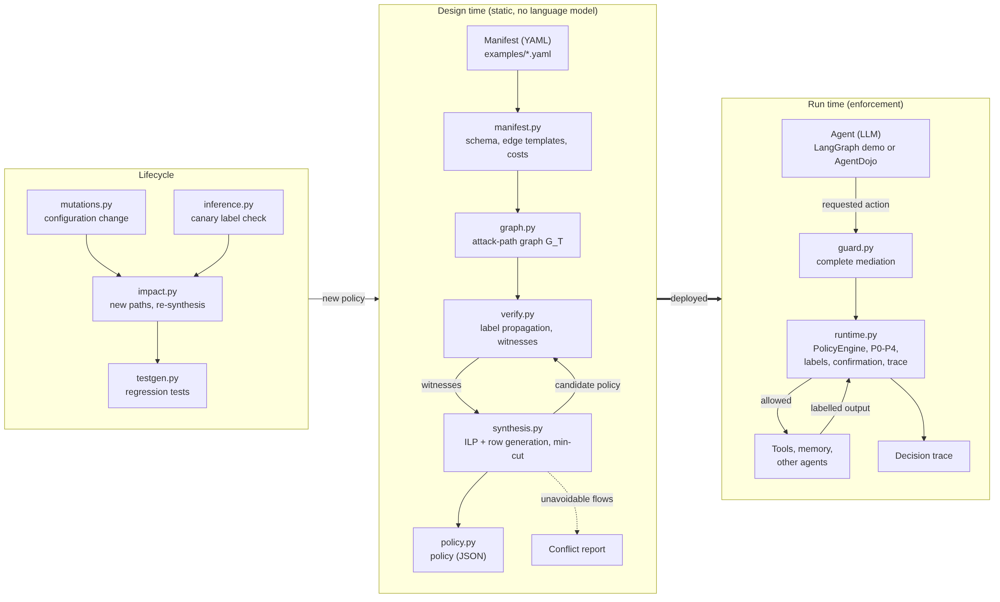

# amps — Agent Manifest → Policy Synthesis

Research prototype for the security of agentic AI systems.

An agent built on a language model reads web pages, e-mails and documents, calls tools,
keeps memories and delegates work to other agents. An attacker who can write in any of
these sources can hide instructions that the model may follow (*indirect prompt
injection*). `amps` does not try to make the model resist this manipulation. It prevents
its **consequence**: no action that matters is executed, and no sensitive data leaves the
system, from a context that attacker-controlled content may have influenced.

From a declarative **manifest** of an agentic system, `amps`:

1. compiles the **attack-path graph** of the system (tools, memories, inter-agent
   messages, users), unrolled over several sessions;
2. finds every integrity and confidentiality **attack path** (a *witness*);
3. **synthesizes the minimal-cost policy** that blocks all of them (integer linear
   programme with row generation, optimal by construction), or reports explicitly the
   tasks that make a secure policy impossible (*security–utility conflict*);
4. **enforces** the policy at run time, outside the model: a policy engine mediates
   every tool call, tool output, memory access, inter-agent message and user prompt,
   and logs every decision;
5. repeats the analysis at **every configuration change** (new tool, new permission,
   new delegation, tool modified by its provider) and generates **regression tests**
   from every new attack path;
6. **checks the labels of the manifest** against the observed behaviour of the real
   tools, with canary strings.



The architecture of the code (modules, dependencies, run-time mediation, experiments)
is described in [`docs/ARCHITECTURE.md`](docs/ARCHITECTURE.md).

**Contents:**
[Main results](#main-results) ·
[Scope of the guarantee](#what-the-guarantee-covers-and-what-it-does-not) ·
[Installation](#installation) ·
[Quick start](#quick-start-no-language-model-needed) ·
[Reproducing the experiments](#reproducing-the-experiments) ·
[Repository layout](#repository-layout)

---

## Main results

All results come from the author's laptop (AMD Ryzen 7 PRO 2700U, 12 GB RAM, no GPU,
Parrot OS). The language model is **Qwen3-4B-Instruct-2507**, quantized to 4 bits
(`q4_K_M`) and served locally by Ollama. AgentDojo queries it with temperature 0, so each
run is deterministic. The benchmark is **AgentDojo 0.1.35** (benchmark version v1.2.2),
**banking** suite: 16 user tasks × 9 injection tasks = 144 attacked cases.

**AgentDojo banking, `important_instructions` attack (144 cases)**

| Configuration | Benign utility (16 tasks) | Attack success rate | Utility under attack |
|---|---|---|---|
| A — no defence | 10/16 | 28/144 (19.4%) | 77/144 (53.5%) |
| Repeat prompt (AgentDojo defence) | 9/16 | 19/144 (13.2%) | 76/144 (52.8%) |
| Delimiting / spotlighting (AgentDojo defence) | 9/16 | 26/144 (18.1%) | 72/144 (50.0%) |
| **B — amps policy** | 7/16 | **0/144** | 59/144 (41.0%) |
| **B_field — amps, field-level labels** | 6/16 | **0/144** | 46/144 (31.9%) |
| **B+H — amps + human confirmation (attentive simulated user)** | **12/16** | **0/144** | **77/144 (53.5%)** |

- Under three AgentDojo attacks (`important_instructions`, `tool_knowledge`,
  `ignore_previous`) on the four tasks that act on a document, B and B+H let **0 of 108**
  attacks through, against 72 of 108 without defence.
- With a *naive* simulated user who approves every request, B+H lets 24 of 36 attacks
  through, exactly as without defence: confirmation protects only as much as the user's
  attention.
- **Lifecycle:** 74 configuration changes generated systematically on four manifests
  opened 38 attack paths that the deployed policy did not stop. All 38 were detected,
  reproduced at run time and closed by the re-synthesized policy. The 20 provider
  "rug pulls" were detected, and the 7 neutral changes raised no alarm. The slowest
  analysis took 92 ms.
- **Scalability:** on synthetic systems of up to 64 agents (512 graph nodes, 6,108
  edges), synthesis took at most 3.0 s and verification at most 18.5 ms.
- **Label check:** the labels of both banking manifests agree with the observed
  behaviour of the 11 tools, and every weakening labelling error introduced on purpose
  was detected (7/7 for each manifest).

## What the guarantee covers, and what it does not

**Covered**, for the flows declared in the manifest:
- **integrity:** an action through a declared sink (payment, e-mail, password change...)
  is never executed from a context that contains untrusted content, unless a human
  approves it;
- **confidentiality:** untrusted and sensitive content never reach an external sink
  together;
- memory poisoning across sessions, and leaks between users through shared memory;
- configuration changes, and tools modified by their provider after approval
  (descriptor registry).

**Not covered:**
- injections that need no action (for example, a distorted answer shown to the user);
- sources missing from the manifest, or labelled *trusted* by mistake (the canary check
  reduces this risk for the locations it seeds, but does not remove it);
- attacks on the model itself (weights, training data), covert channels, and the
  compromise of the trusted base (policy engine, orchestrator);
- remote agents whose tool calls the engine cannot observe;
- a human who approves confirmation requests without reading them.

**Limits of the evidence:** one small model, one AgentDojo suite, non-adaptive attacks,
hand-written manifests, and a simulated user instead of real users. The prototype is
validated in a laboratory setting, not in production.

---

## Installation

**Requirements:** Linux (tested on Parrot OS), Python 3.11 or later, Conda (optional).
No GPU is needed. The AgentDojo experiments also need [Ollama](https://ollama.com).

```bash
git clone https://github.com/luc-isengwe/amps.git
cd REPLACE_WITH_MY_REPOSITORY

conda create -n amps python=3.11 -y
conda activate amps

pip install -r requirements.txt     # dependencies of amps, of the experiments, and pytest
pip install -e .                    # the amps package and its command line
pytest -q                           # 93 tests, a few seconds
```

`requirements.txt` installs everything: the framework (`pydantic`, `PyYAML`, `networkx`,
`pulp`), the demonstrator (`langgraph`), the experiments (`agentdojo`, `matplotlib`) and
`pytest`. PuLP is pinned to **2.9.0**, the last version that bundles the CBC solver: with
a later version the synthesis fails unless CBC is installed separately. AgentDojo is
pinned to **0.1.35**, the version used in the experiments.

`requirements-lock.txt` lists the exact version of every package of the environment in
which the experiments were run.

## Quick start (no language model needed)

```bash
# Validate a manifest and list its attack paths without any policy
amps validate   examples/demo_4agents.yaml
amps verify     examples/demo_4agents.yaml

# Synthesize the minimal policy (cost 2.7) and check that no attack path remains
mkdir -p results
amps synthesize examples/demo_4agents.yaml -o results/policy.json
amps verify     examples/demo_4agents.yaml -p results/policy.json

# Lifecycle: give the reviewer agent the e-mail tool, then analyse the change.
# Two new attack paths are found; the re-synthesized policy costs 4.5.
amps mutate examples/demo_4agents.yaml permission_drift agent=reviewer tool=send_email -o results/drift.yaml
amps impact examples/demo_4agents.yaml results/drift.yaml -p results/policy.json \
            -o results/drift_policy.json --tests tests/generated
pytest -q tests/generated           # the generated regression tests pass
```

`amps verify` exits with code 1 when it finds an attack path and 0 when the system is
safe, so it can be used directly as a check in continuous integration.

The command line has six commands: `validate`, `graph`, `verify`, `synthesize`, `mutate`
and `impact`. `amps <command> --help` lists the options of each.

---

## Reproducing the experiments

Run every command from the repository folder, with the `amps` environment active.

### 1. Static and scripted experiments (no language model, a few seconds each)

| Command | Result | Output in `results/` |
|---|---|---|
| `python experiments/run_utility_t1.py` | four-agent demonstrator, 30 workflows (A, B, B_util, B_sink, B_strict) | `utility_t1_summary.json`, `utility_t1_workflows.csv` |
| `python experiments/run_lifecycle.py` | impact analysis of the 74 configuration changes | `lifecycle_mutations.csv`, `lifecycle_summary.json` |
| `python experiments/run_scalability.py` | synthesis and verification time, 2 to 64 agents | `scalability.csv` |
| `python experiments/cost_sensitivity.py` | 1,000 random cost settings | `cost_sensitivity.json` |
| `python experiments/predict_banking.py` | static prediction for each banking task | `banking_prediction.csv` |
| `python experiments/banking_fields_study.py` | field-level labels and human confirmation, without a model | `banking_fields_study.csv`, `banking_fields_summary.json` |

`python experiments/run_scalability.py --quick` runs a small grid for a first test.
The times depend on the machine; the sizes of the graphs, the policies and their
security do not (fixed seeds).

### 2. Policies and simulated users for the AgentDojo runs

These commands write the files used by the AgentDojo integration scripts.

```bash
amps synthesize examples/banking.yaml -o results/banking_policy_B.json    # configuration B (cost 9.0)
python experiments/make_banking_field_policy.py                            # B_field: results/banking_policy_Bfield.json
python experiments/make_banking_H_policies.py                              # B+H: results/banking_policy_BH.json (cost 12.0)
python experiments/simulated_human.py                                      # reference calls + self-test of the simulated users
python experiments/check_groundtruth_banking.py                            # AgentDojo reference calls replayed through the engine
```

`simulated_human.py` writes `results/banking_ground_truth.json` and checks that the
attentive user approves the 14 legitimate sink calls of the reference solutions and
refuses the 176 sink calls of the injection tasks.

### 3. AgentDojo runs (local model, about 7.5 hours per attacked configuration)

**Model.** Install Ollama, then download the model once:

```bash
ollama pull qwen3:4b-instruct-2507-q4_K_M
```

Ollama must be running (`ollama serve`, if it is not already started as a service).
AgentDojo reaches it through its OpenAI-compatible endpoint, on the port given by
`LOCAL_LLM_PORT`:

```bash
export LOCAL_LLM_PORT=11434
```

**Baselines (A, repeat prompt, delimiting).** Each configuration has its own folder in
`runs/`. A command without `--attack` runs the 16 benign tasks; with
`--attack important_instructions` it runs the 144 attacked cases.

```bash
# A: no defence
python -m agentdojo.scripts.benchmark -s banking --model LOCAL --model-id qwen3:4b-instruct-2507-q4_K_M --logdir runs/qwen3-4b-instruct_A
python -m agentdojo.scripts.benchmark -s banking --model LOCAL --model-id qwen3:4b-instruct-2507-q4_K_M --logdir runs/qwen3-4b-instruct_A --attack important_instructions

# Repeat prompt
python -m agentdojo.scripts.benchmark -s banking --model LOCAL --model-id qwen3:4b-instruct-2507-q4_K_M --logdir runs/qwen3-4b-instruct_repeat --defense repeat_user_prompt
python -m agentdojo.scripts.benchmark -s banking --model LOCAL --model-id qwen3:4b-instruct-2507-q4_K_M --logdir runs/qwen3-4b-instruct_repeat --defense repeat_user_prompt --attack important_instructions

# Delimiting (spotlighting)
python -m agentdojo.scripts.benchmark -s banking --model LOCAL --model-id qwen3:4b-instruct-2507-q4_K_M --logdir runs/qwen3-4b-instruct_spotlight --defense spotlighting_with_delimiting
python -m agentdojo.scripts.benchmark -s banking --model LOCAL --model-id qwen3:4b-instruct-2507-q4_K_M --logdir runs/qwen3-4b-instruct_spotlight --defense spotlighting_with_delimiting --attack important_instructions

# Reproducibility check: second attacked run of A (same outcome in all 144 cases)
python -m agentdojo.scripts.benchmark -s banking --model LOCAL --model-id qwen3:4b-instruct-2507-q4_K_M --logdir runs/qwen3-4b-instruct_A2 --attack important_instructions

# A under the two other attacks, on the four tasks that read a file (36 cases each)
python -m agentdojo.scripts.benchmark -s banking --model LOCAL --model-id qwen3:4b-instruct-2507-q4_K_M --logdir runs/qwen3-4b-instruct_A --attack tool_knowledge -ut user_task_0 -ut user_task_2 -ut user_task_12 -ut user_task_13
python -m agentdojo.scripts.benchmark -s banking --model LOCAL --model-id qwen3:4b-instruct-2507-q4_K_M --logdir runs/qwen3-4b-instruct_A --attack ignore_previous -ut user_task_0 -ut user_task_2 -ut user_task_12 -ut user_task_13
```

AgentDojo writes one JSON file per case, in
`runs/<run>/<pipeline>/banking/user_task_<i>/<attack>/injection_task_<j>.json`; the
pipeline folder is `local` for A, `local-repeat_user_prompt` and
`local-spotlighting_with_delimiting` for the two defences. A run that stops can be
started again with the same command: the cases already completed are kept. The warning
`No .env file found` is harmless.

**amps configurations (B, B_field, B+H).** In these scripts, the amps engine replaces
the tool-execution element of the AgentDojo pipeline; the agent, the system prompt, the
model and the attacks are those of AgentDojo. Each script writes into its own folder
of `runs/`; the B+H scripts also log every confirmation request in
`results/qwen3-4b-instruct_BH_*_calls.jsonl`.

The scripts take no command-line options: the configuration and the attack are fixed
inside each script. Run them from the root of the repository, with Ollama running.

| Configuration | Attack | Command |
|---|---|---|
| B | none (benign utility) | `python experiments/amps_agentdojo_B.py` |
| B | `important_instructions` | `python experiments/amps_agentdojo_B_attack.py` |
| B | `tool_knowledge` | `python experiments/amps_agentdojo_B_tool_knowledge.py` |
| B | `ignore_previous` | `python experiments/amps_agentdojo_B_ignore_previous.py` |
| B_field | none (benign utility) | `python experiments/amps_agentdojo_Bfield.py` |
| B_field | `important_instructions` | `python experiments/amps_agentdojo_Bfield_attack.py` |
| B+H | none (benign utility) | `python experiments/amps_agentdojo_BH.py` |
| B+H | `important_instructions` | `python experiments/amps_agentdojo_BH_attack.py` |
| B+H, naive user | `important_instructions` | `python experiments/amps_agentdojo_BH_attack_naive.py` |
| B+H | `tool_knowledge` | `python experiments/amps_agentdojo_BH_attack_tool_knowledge.py` |
| B+H | `ignore_previous` | `python experiments/amps_agentdojo_BH_attack_ignore_previous.py` |

The B_field scripts use the field-level policy `results/banking_policy_Bfield.json`,
produced by `experiments/make_banking_field_policy.py` from
`examples/banking_fields_noH.yaml`.

### 4. Label check with canaries

```bash
python experiments/collect_observations.py                                                         # calls the 11 tools with canaries: results/banking_observations.json
python experiments/infer_manifest.py results/banking_observations.json examples/banking.yaml        # session-level manifest
python experiments/infer_manifest.py results/banking_observations.json examples/banking_fields.yaml # field-level manifest
python experiments/label_mutation_study.py results/banking_observations.json examples/banking.yaml
python experiments/label_mutation_study.py results/banking_observations.json examples/banking_fields.yaml
```

The specification of the observations is in `docs/CANARY_OBSERVATIONS_FR.md`.

### 5. Analysis of the runs and figures

```bash
python experiments/compare_runs.py                                  # important_instructions: ASR, utility, Wilson intervals, McNemar tests
python experiments/compare_runs.py local-amps_BH tool_knowledge     # second attack
python experiments/compare_runs.py local-amps_BH ignore_previous    # third attack
python experiments/make_figures.py                                  # figures 1 to 6, in figures/ (PDF and PNG)
```

---

## Repository layout

```
amps/            the framework, one module per component (see docs/ARCHITECTURE.md)
amps_demo/       four-agent customer-support demonstrator (LangGraph, simulated tools)
examples/        manifests: four-agent demonstrator; AgentDojo banking at session and
                 field level, with and without human confirmation; multi-tenant
                 support assistant
experiments/     the scripts of every experiment, analysis and figures
scripts/         throughput benchmark of local models served by Ollama
tests/           93 automated tests
results/         result files (CSV, JSON), synthesized policies, confirmation logs
runs/            raw AgentDojo results, one JSON file per case
figures/         figures (PDF and PNG)
docs/            architecture, canary observation specification
```

## Tests

`pytest -q` runs 93 tests. Among other properties, they check that the optimum of the
integer programme equals the optimum found by exhaustive search on small systems, that
every attack path found statically succeeds at run time without policy and is blocked
with the synthesized policy, that the synthesized policies reach the lower bound on
human confirmations, that generated regression tests pass with the new policy and fail
with the old one, and that labelling errors are detected by the canary check.

## Acknowledgements

The empirical evaluation uses [AgentDojo](https://github.com/ethz-spylab/agentdojo)
(Debenedetti et al., NeurIPS 2024, Datasets and Benchmarks Track). The attacks are those
provided by AgentDojo; this repository contains no new attack.

## License

This project is released under the MIT License. See the [LICENSE](LICENSE) file.
