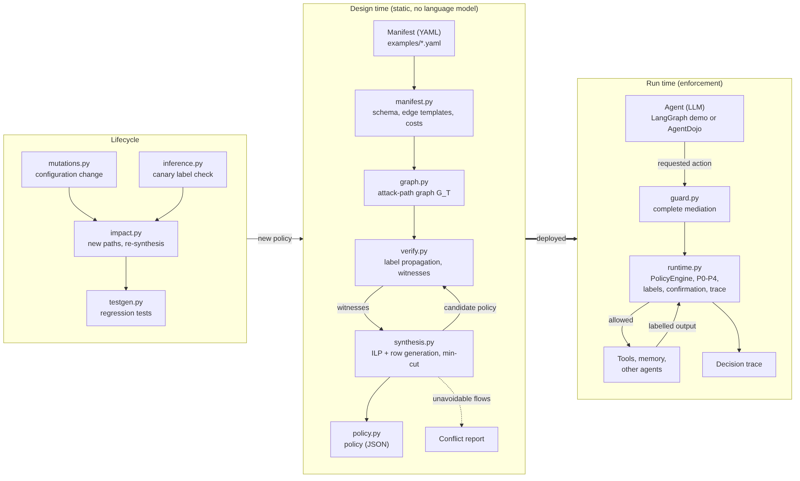
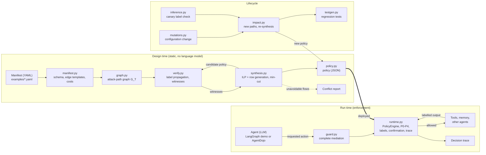
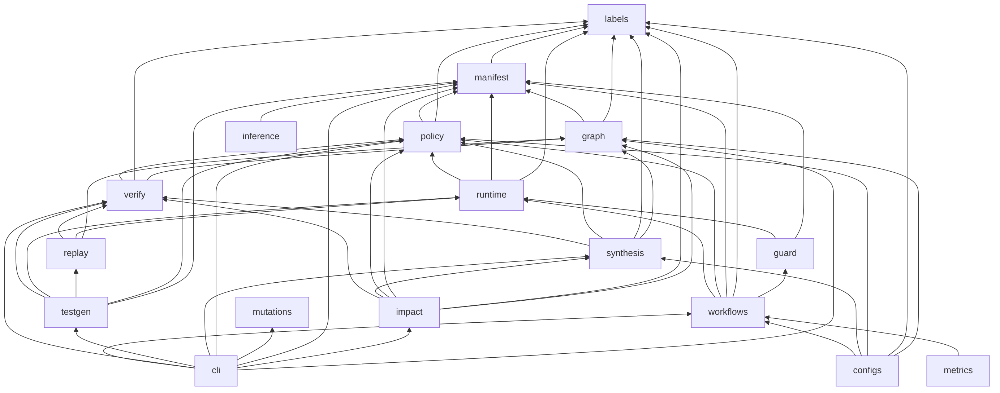
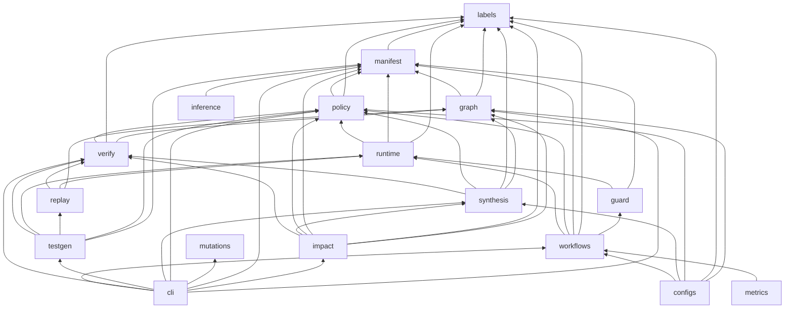
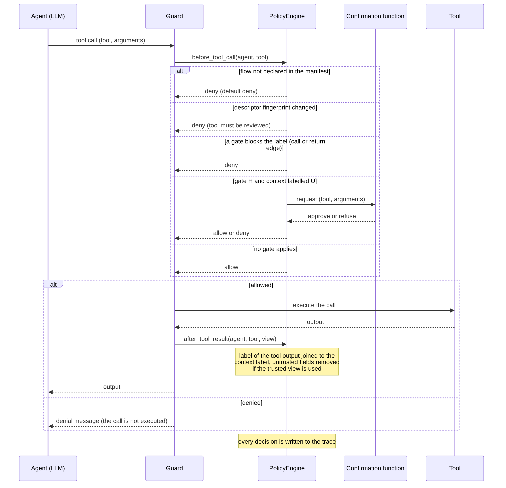
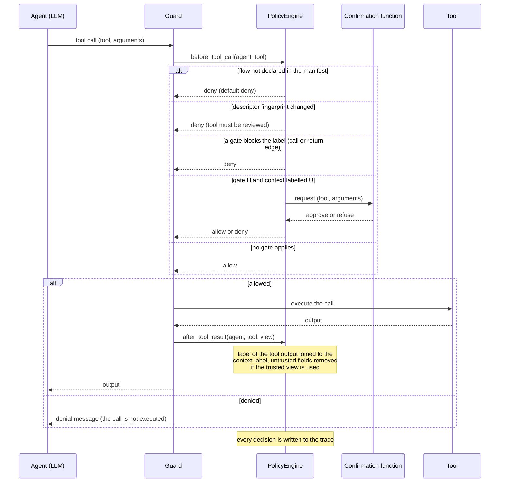
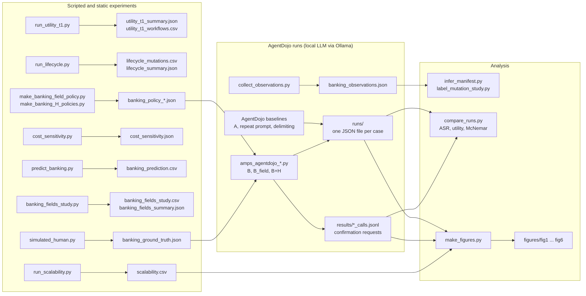
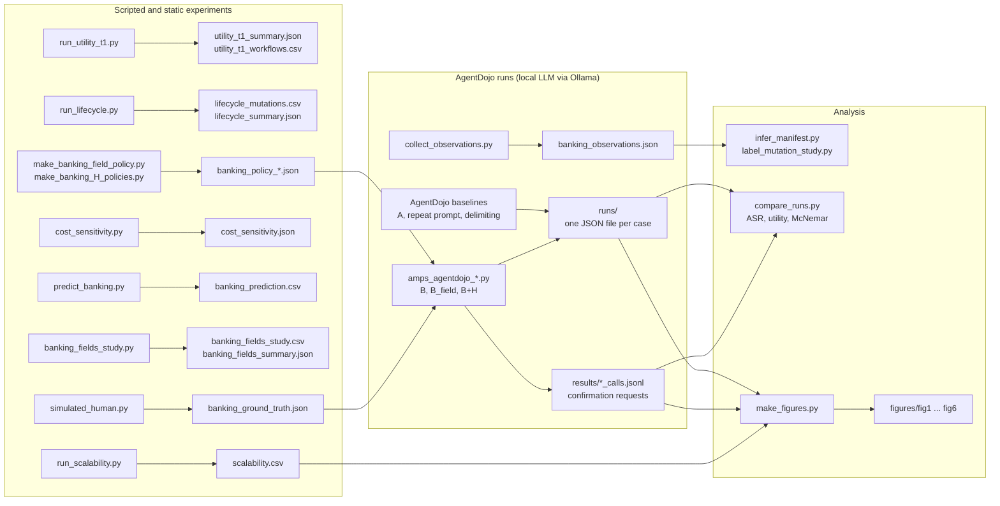

# Architecture of the code

This document describes how the code of `amps` is organized: the three phases of the
framework, the modules of the package and their dependencies, how an action is mediated
at run time, and how the experiments produce their results and figures.

The diagrams are written in Mermaid, which GitHub displays directly. PNG versions are in
this folder (`architecture_overview.png`, `architecture_modules.png`,
`architecture_runtime.png`, `architecture_experiments.png`).

The framework (`amps/`) has about 3,800 lines of Python; the demonstrator, the experiments
and the tests have about 3,400 more.

---

## 1. Overview: three phases

- **Design time.** The manifest is validated and compiled into the attack-path graph.
  The verifier and the synthesizer iterate until no attack path remains: the result is a
  policy of minimal cost, or a report of the flows that cannot be blocked without
  breaking a declared task.
- **Run time.** The agent never touches a tool, a memory or another agent directly. Each
  action is a request to the guard, which asks the policy engine and executes the action
  only if it is allowed. The engine tracks labels, never content, and logs every decision.
- **Lifecycle.** A configuration change is analysed against the deployed policy; new
  attack paths are closed by re-synthesis and become regression tests. The labels of new
  or modified tools can be checked against their observed behaviour with canaries.

---

## 2. Modules of the package `amps/`

| Module | Role | Main elements |
|---|---|---|
| `labels.py` | Labels `{U, S}` and gate modes `R, I, C, H`; the two shared functions `blocks` (security view) and `breaks_task` (utility view) | `Mode`, `blocks`, `breaks_task`, `integrity_violation`, `confidentiality_violation` |
| `manifest.py` | Manifest schema (Pydantic, unknown keys rejected), validation, edge templates, cost model, field-level views | `Manifest`, `Tool`, `Agent`, `Task`, `Controls`, `EdgeTemplate`, `load_manifest` |
| `graph.py` | Compiles the manifest into the graph G_T unrolled over T sessions | `CompiledGraph`, `compile_manifest` |
| `verify.py` | Propagates labels to a fixed point, finds violations and their witnesses | `verify`, `Witness`, `VerificationResult` |
| `synthesis.py` | Minimal policy: ILP with row generation (PuLP + CBC), min-cut for the integrity-only single-session case, conflicts | `synthesize`, `synthesize_ilp`, `synthesize_mincut`, `Conflict` |
| `policy.py` | Policy file (JSON), with the descriptor fingerprints; difference between two policies | `Policy`, `diff_policies` |
| `runtime.py` | Policy engine: enforcement points P0–P4, default deny, label tracking, projection of trusted fields, human confirmation, descriptor registry, trace | `PolicyEngine`, `Decision`, `project_output` |
| `guard.py` | Complete mediation: executes an action only if the engine allows it | `Guard`, `Action`, `Outcome` |
| `replay.py` | Replays a static witness against the engine, searching the allowed interleavings | `replay_witness` |
| `workflows.py` | Legitimate workflows derived from the tasks, usage profiles, confirmation lower bound | `task_workflows`, `mixed_workflows`, `confirmation_lower_bound` |
| `configs.py` | Policies compared on the demonstrator | `config_A`, `config_B`, `config_B_util`, `config_B_sink`, `config_B_strict` |
| `mutations.py` | The seven types of configuration change | `rug_pull`, `permission_drift`, `new_delegation`, `widen_memory`, `add_sink_tool`, `neutral_tool`, `retire_agent` |
| `impact.py` | Impact analysis of a change: structural difference, deployed policy re-verified, warm-started re-synthesis, stale gates | `impact_analysis`, `ImpactReport` |
| `testgen.py` | Regression tests generated from the witnesses (stored as data) | `generate_regression_tests` |
| `inference.py` | Label check: compares the manifest with canary observations | `collect_evidence`, `compare`, `unsafe` |
| `metrics.py` | Wilson intervals and utility summaries | `wilson`, `utility_summary` |
| `cli.py` | Command line: `validate`, `graph`, `verify`, `synthesize`, `mutate`, `impact` | `main` |

### Dependencies between modules

Each arrow means "imports". The diagram is drawn from the `import` statements of the code.

`labels.py` is the base of the whole package: the verifier, the synthesizer and the
runtime engine all use the same `blocks` function, so what is proved statically is what
is enforced at run time. `mutations.py` works on the manifest as plain data and imports
no other module.

---

## 3. How an action is mediated at run time

The same engine has entry points for the other enforcement points: `user_prompt` (P0),
`memory_write` (P2), `memory_read` (P3) and `send_message` (P4). The engine never reads
the content of prompts or outputs: its decisions depend only on labels, so an injected
instruction cannot change them.

---

## 4. Integrations

| Integration | Where | How the engine is used |
|---|---|---|
| Four-agent demonstrator | `amps_demo/app.py`, `amps_demo/tools.py` | LangGraph application whose orchestrator routes every action of the four agents (supervisor, retrieval, executor, reviewer) through `Guard`; tools are simulated |
| AgentDojo banking suite | `experiments/amps_agentdojo_*.py` | the engine replaces the tool-execution element of the AgentDojo pipeline; the agent, the system prompt and the model are unchanged |
| Human confirmation | `experiments/simulated_human.py` | attentive and naive simulated users, given to the engine as its confirmation function |

---

## 5. Experiments, results and figures

| Figure | File | Data |
|---|---|---|
| Security and utility of the six configurations | `fig1_security_utility` | `runs/` |
| Three attacks on the file-based tasks | `fig2_attacks` | `runs/` |
| Where the attacks succeed | `fig3_where_attacks_succeed` | `runs/` |
| Sink calls under the three amps policies | `fig4_sink_calls` | `runs/` and `results/*_calls.jsonl` |
| Scalability | `fig5_scalability` | `results/scalability.csv` |
| Human confirmation, attentive and naive user | `fig6_human` | `runs/` |

---

## 6. Tests

The folder `tests/` contains 93 automated tests (`pytest -q`). Among other properties,
they check that:

- the optimum of the ILP equals the optimum found by exhaustive search on small systems;
- the minimum cut and the ILP give the same cost in the integrity-only case;
- every static witness succeeds at run time without policy and is blocked with the
  synthesized policy (agreement between `verify.py` and `runtime.py`);
- the synthesized policies reach the lower bound on human confirmations;
- the generated regression tests pass with the new policy and fail with the old one;
- labelling errors are detected by the canary check;
- the banking manifest declares every tool used by the AgentDojo reference solutions.
